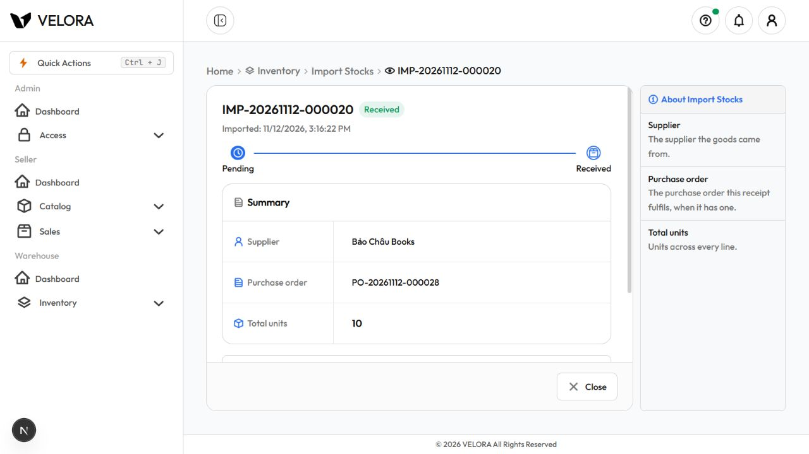
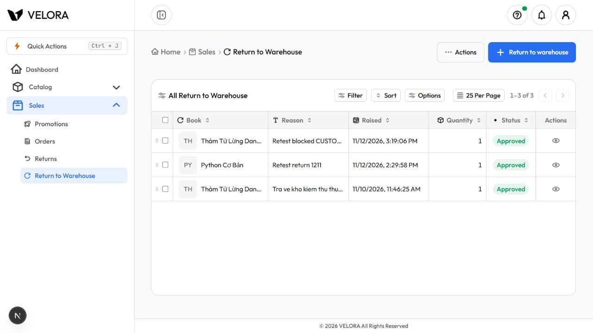

# Chạy lại 13 case Blocked — 2026-11-12

**13/13 case đạt theo phạm vi bằng chứng ghi bên dưới. Tổng hợp mới: 53 Pass (UI/API), 2 Accepted, 0 Blocked trong 55 case.** Không coi lỗi điều hướng đã được sửa: lần này đi vòng qua lỗi bằng URL giữ tiền tố `/admin/warehouse/...`.

## Cách chạy và bằng chứng

- In-app browser: Admin `localhost:3000`, Warehouse `localhost:3001`, Seller `localhost:3002`; dùng tài khoản mẫu tương ứng. Admin giữ đường dẫn `/admin/warehouse/...`, kể cả khi mở lại sau thao tác thành công bị chuyển về đường dẫn Warehouse thường.
- API trực tiếp: gateway `localhost:8080`, đăng nhập riêng theo vai trò; kiểm tra HTTP status, đọc lại bản ghi và tồn kho. Case thiếu Order đi qua Seller BFF `localhost:3002` vì ràng buộc cặp RMA/Order được kiểm tra ở BFF.
- Postman CLI được thử nhưng gửi payload đăng nhập không thành công trong lần này; chuyển sang PowerShell `Invoke-WebRequest`. Kết quả bên dưới là HTTP thật từ PowerShell, không phải kết quả Postman collection. Không lưu token/mật khẩu vào artifact.
- [31 kiểm tra HTTP, toàn bộ đạt status mong đợi](blocked-api-results.json), gồm bước chuẩn bị dữ liệu và đọc lại. Không phải 31 test case độc lập. Các kiểm tra bổ sung xác nhận nguồn CUSTOMER_RETURN, cặp RMA/Order, trạng thái RECEIVED/APPROVED, tồn tăng đúng và không tăng khi duyệt lại.
- Các lần chạy trước giữ tại [báo cáo gốc](README.md) và [snapshot JSON trước chạy lại](results-before-blocked-rerun.json). [results.json](results.json) là tổng hợp mới; mỗi case cập nhật có `previousResult` để giữ kết quả Blocked cũ.

## Kết quả 13 case

| Nhóm | Case | Kết quả | Bằng chứng thực tế |
|---|---|---|---|
| Đơn mua | TC06 | Pass API | Warehouse PATCH approve PO mới đang PENDING nhận 403 FORBIDDEN; sau đó Admin duyệt và đánh dấu đã đặt thành công. |
| Nhập kho | TC01 | Pass UI + API đọc lại | Tạo phiếu IMP-20261112-000020 từ PO mới đặt 10 cuốn, Receive trên UI bằng phiên Admin đúng; đọc API thấy received=true, PO RECEIVED; tồn Python Cơ Bản/Bìa mềm 63 → 73 (+10). Chưa thu HTTP response của thao tác tạo/Receive trên browser. |
| Nhập kho | TC02 | Pass API | Gửi nhập khi PO mới còn APPROVED: 409 CONFLICT; sau đó mới chuyển PO ORDERED để chạy case khác. |
| Nhập kho | TC03 | Pass API | Gửi details=[] với PO ORDERED: 400 VALIDATION_ERROR, không tạo phiếu. |
| Nhập kho | TC04 | Pass API | Giá nhập -1 với số lượng 5, PO ORDERED: 400 VALIDATION_ERROR. Giá nhập trên UI lấy từ PO nên dùng API để kiểm tra dữ liệu âm. |
| Nhập kho | TC05 | Pass API | PO riêng đặt 2, tạo phiếu IMP-20261112-000021 với đúng 2: HTTP 201; Receive HTTP 200; tồn 61 → 63 (+2), PO RECEIVED. Case này chạy trước Receive của TC01. |
| Nhập kho | TC06 | Pass UI + API | UI số lượng 0 báo “A receipt needs at least one line with a quantity.”; gửi quantity=0 trực tiếp: HTTP 400. |
| Nhập kho | TC07 | Pass UI + API | UI nhập 11 cho PO đặt 10 báo “A line cannot receive more than the order still owes.”; API gửi 3 cho PO riêng đặt 2 nhận 409. |
| Yêu cầu/trả kho | TC03 | Pass UI + API đọc lại | Seller mở `/seller/stock-returns?fromReturn=2`; tạo RTW-20261112-000022, UI thấy Pending. API đọc lại xác nhận CUSTOMER_RETURN, returnRequestId=2, orderId=17, bookId=46, quantity=1. Chưa thu HTTP 201 từ browser. |
| Yêu cầu/trả kho | TC04 | Pass UI + API đọc lại | Warehouse duyệt RTW-20261112-000022 trên UI; API xác nhận APPROVED, tồn sách 46 tăng 49 → 50; Seller đọc lại Approved trên cả UI và API. |
| Yêu cầu/trả kho | TC06 | Pass API | Tạo STK mới PENDING rồi dùng Warehouse PATCH approve: 403 FORBIDDEN. |
| Yêu cầu/trả kho | TC09 | Pass BFF API | Seller đã đăng nhập, gửi returnRequestId=2 nhưng thiếu orderId đến BFF: 400, “returnRequestId: returnRequestId and orderId travel together”. Không coi đây là kiểm tra backend trực tiếp. |
| Yêu cầu/trả kho | TC10 | Pass API | Warehouse gọi approve lần hai trên RTW mới đã APPROVED: 409 CONFLICT; đọc lại tồn vẫn 50. Đã thử thêm RTW APPROVED có sẵn và cũng nhận 409. |

## Dữ liệu giữ lại

- PO-20261112-000028 (ID 4): Python Cơ Bản/Bìa mềm, 10 × 50.000đ, đã RECEIVED qua IMP-20261112-000020 (ID 4).
- PO-20261112-000029 (ID 5): cùng sách/định dạng, 2 × 50.000đ, đã RECEIVED qua IMP-20261112-000021 (ID 5).
- Tồn sách 9/định dạng 1 tăng tổng cộng 12 trong đợt này: 61 → 73. Tạo phiếu 10 cuốn chưa làm tăng tồn (đã đọc lại 61); Receive phiếu 2 cuốn tăng 61 → 63, sau đó Receive phiếu 10 cuốn tăng 63 → 73.
- STK-20261112-000020 (ID 4): sách 9, số lượng 1, PENDING, dùng kiểm tra Warehouse không được duyệt; giữ nguyên sau khi bị từ chối.
- RTW-20261112-000022 (ID 3): nguồn CUSTOMER_RETURN, dùng lại fixture RMA 2 / đơn 17 của test gốc, sách 46 số lượng 1; Warehouse đã duyệt APPROVED, tồn 49 → 50. RMA này có bản ghi trả kho lịch sử; lần này không kiểm tra tính duy nhất theo RMA.
- PO-20261112-000027 đã là RECEIVED khi bắt đầu đợt này; không dùng nó làm fixture nhập mới và không quy thao tác Receive đó cho lần chạy này.

## Giới hạn còn lại

Không sửa source, quyền, API/schema; không commit/push. Lỗi mất tiền tố Admin vẫn tồn tại; kết quả đạt nhờ đi vòng và gọi API khi UI không biểu diễn được tình huống âm. Không chạy unit test/build hoặc sáu luồng tổng hợp riêng trong `backoffice/luong.md`; hai case Accepted vẫn chưa kiểm tra lưu sau chuẩn hóa giá âm. Dữ liệu/tồn kho test đã thay đổi như liệt kê, không hoàn tác.

## Ảnh bằng chứng

