# Danh sách lỗi - đợt test 2026-11-27

[← Tổng quan đợt test](README.md)

| # | Mức độ | Loại | Lỗi | Nghi ngờ thuộc |
|---|---|---|---|---|
| [B01](#b01) | Major | Lỗi chức năng | Một yêu cầu trả hàng lập được nhiều phiếu trả về kho, và số lượng không được đối chiếu: tồn kho bị cộng nhiều lần | inventory-service (bảng chống trùng processed_order_returns đã bị xoá ở migration V12) |
| [B02](#b02) | Major | Lỗi chức năng | Mã khuyến mãi chỉ còn 1 lượt nhưng 2 khách đặt cùng lúc đều được giảm | order-service, promotion-service |
| [B03](#b03) | Major | Lỗi chức năng | Trang chủ storefront sập hoàn toàn khi một sách có ảnh bìa từ host không khai báo | taschen-storefront (next/image), catalog-service (không kiểm host của imageUrl) |
| [B04](#b04) | Major | Lỗi chức năng | Tồn kho ban đầu nhập ở phiên bản hiện "còn 10" trên storefront nhưng không có hàng thật | catalog-service (book_variants.stock_quantity tách khỏi inventory) |
| [B05](#b05) | Major | Lỗi chức năng | Giá nhập bằng 0 gây lỗi 500 thay vì báo lỗi kiểm tra | inventory-service |
| [B06](#b06) | Major | Lỗi chức năng | Tạo được đơn mua với nhà cung cấp đã ngừng hoạt động (qua API) | inventory-service |
| [B07](#b07) | Major | Lỗi chức năng | Duyệt trả về kho cho sách chưa có lô: phiếu báo APPROVED nhưng hàng không vào kho, không có lỗi | inventory-service (BatchServiceImpl.restockReturnedUnits) |
| [B08](#b08) | Minor | Lỗi chức năng | Mã danh mục và mã khuyến mãi nhận chữ thường và dấu cách, trái với hướng dẫn | catalog-service, promotion-service |
| [B09](#b09) | Minor | Nội dung Guide me | Guide me nói banner có nút bật/tắt và đường dẫn, nhưng form không có | taschen-backoffice (guide seller), catalog-service |
| [B10](#b10) | Minor | Nội dung Guide me | Tip số lượt ngụ ý được tạo khuyến mãi không giới hạn, nhưng hệ thống bắt buộc số lượt | taschen-backoffice (guide seller) |
| [B11](#b11) | Minor | Nội dung Guide me | Guide me nói từ chối thì đơn đóng lại, nhưng khách vẫn gửi được yêu cầu mới | order-service hoặc nội dung guide |
| [B12](#b12) | Minor | Nội dung Guide me | Guide me nói bấm Đã nhận thì "tiền đã hoàn", thực tế chỉ mở khoản hoàn chờ chi | taschen-backoffice (guide seller) |
| [B13](#b13) | Minor | Nội dung Guide me | Guide me nói Admin quyết số lượng cuối cùng, nhưng không có chỗ sửa số lượng khi duyệt | inventory-service, taschen-backoffice |
| [B14](#b14) | Minor | Nội dung Guide me | Guide me mô tả trạng thái cuối "Đã nhận" cho yêu cầu nhập, hệ thống không có trạng thái này | inventory-service hoặc guide warehouse |
| [B15](#b15) | Minor | Nội dung Guide me | Guide me bước duyệt nói duyệt xong là nhận hàng được, thực tế phải qua bước Thanh toán | taschen-backoffice (guide warehouse) |

## B01

**Một yêu cầu trả hàng lập được nhiều phiếu trả về kho, và số lượng không được đối chiếu: tồn kho bị cộng nhiều lần**

| Trường | Nội dung |
|---|---|
| **Mức độ** | Major |
| **Trạng thái** | Chưa sửa. Phát hiện ngày 2026-11-27 khi test theo Guide me. |
| **Bug liên quan** | Gần giống [SF-40](../storefront/loi.md#sf-40) (trùng yêu cầu đổi trả), nhưng lỗi này nằm ở bước lập phiếu trả về kho |
| **Loại** | Lỗi chức năng |
| **Luồng** | Trả hàng → trả về kho |
| **Endpoint / Màn hình** | POST /api/v1/inventory/return-to-warehouse · PATCH .../{id}/approve |
| **Nghi ngờ thuộc** | inventory-service (bảng chống trùng processed_order_returns đã bị xoá ở migration V12) |
| **Case** | GM06-07, GM06-08, GM11-04 |
| **Bước tái hiện** | 1. Khách trả 1 cuốn Sapiens (RMA-20261127-000064), Seller duyệt và bấm Đã nhận 2. Seller lập phiếu trả về kho 1 cuốn (RTW-...066) 3. Seller lập thêm phiếu thứ hai cho cùng yêu cầu (RTW-...067) và phiếu khai 50 cuốn (RTW-...068) 4. Warehouse duyệt RTW-066 rồi RTW-067 |
| **Mong đợi** | Chỉ một phiếu trả về kho cho mỗi yêu cầu trả hàng, số lượng không vượt số khách trả; tồn tăng đúng 1 |
| **Thực tế** | Cả ba phiếu đều tạo được (201). Duyệt hai phiếu: tồn bìa mềm 14 → 15 → 16, tức cộng 2 cuốn cho 1 cuốn khách trả. Phiếu 50 cuốn cũng duyệt được nếu Warehouse không để ý |
| **API Response** | <pre>POST /api/v1/inventory/return-to-warehouse Request body: {   "reason": "Khách trả 1 cuốn, sách còn nguyên seal, đưa lại lên kệ",   "items": [     {       "bookId": 67,       "variantId": 1,       "quantity": 1     }   ],   "returnRequestId": 64,   "orderId": 184 } HTTP 201 {   "success": true,   "data": {     "id": 47,     "returnCode": "RTW-20261127-000066",     "reason": "Khách trả 1 cuốn, sách còn nguyên seal, đưa lại lên kệ",     "responseNote": null,     "status": "PENDING",     "source": "CUSTOMER_RETURN",     "createdAt": "2026-11-27T04:24:27.095739800Z", … (rút gọn)</pre> [Đầy đủ](api/GM06-07.txt)<pre>POST /api/v1/inventory/return-to-warehouse Request body: {   "reason": "Khai số lượng lớn hơn số khách thật sự trả",   "items": [     {       "bookId": 67,       "variantId": 1,       "quantity": 50     }   ],   "returnRequestId": 64,   "orderId": 184 } HTTP 201 {   "success": true,   "data": {     "id": 49,     "returnCode": "RTW-20261127-000068",     "reason": "Khai số lượng lớn hơn số khách thật sự trả",     "responseNote": null,     "status": "PENDING",     "source": "CUSTOMER_RETURN",     "createdAt": "2026-11-27T04:24:31.818090100Z", … (rút gọn)</pre> [Đầy đủ](api/GM06-08.txt)<pre>PATCH /api/v1/inventory/return-to-warehouse/47/approve Request body: {   "responseNote": "Đã kiểm hàng, sách còn tốt" } HTTP 200 {   "success": true,   "data": {     "id": 47,     "returnCode": "RTW-20261127-000066",     "reason": "Khách trả 1 cuốn, sách còn nguyên seal, đưa lại lên kệ",     "responseNote": "Đã kiểm hàng, sách còn tốt",     "status": "APPROVED",     "source": "CUSTOMER_RETURN",     "createdAt": "2026-11-27T04:24:27.095740Z",     "processedAt": "2026-11-27T04:24:36.359709100Z",     "createdByUserId": 96,     "processedByUserId": 97,     "returnRequestId": 64,     "orderId": 184,     "items": [       {         "id": 47,         "bookId": 67, … (rút gọn)</pre> [Đầy đủ](api/GM11-04.txt) |
| **Ảnh bằng chứng** | [GM06-07: ảnh 1](images/GM06-07-1.png) [GM06-08: ảnh 1](images/GM06-08-1.png) [GM11-04: ảnh 1](images/GM11-04-1.png) |

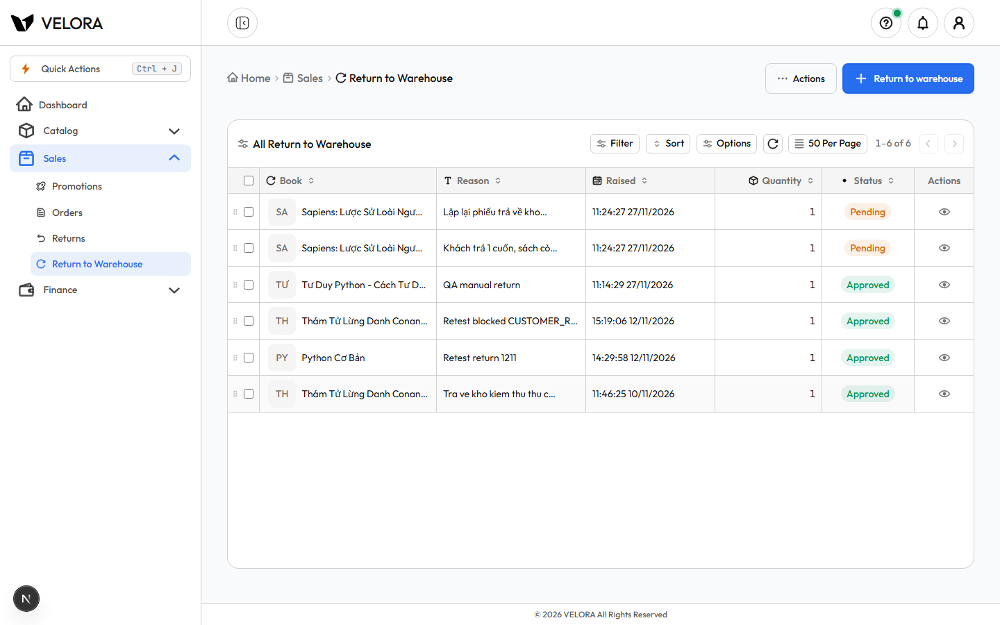

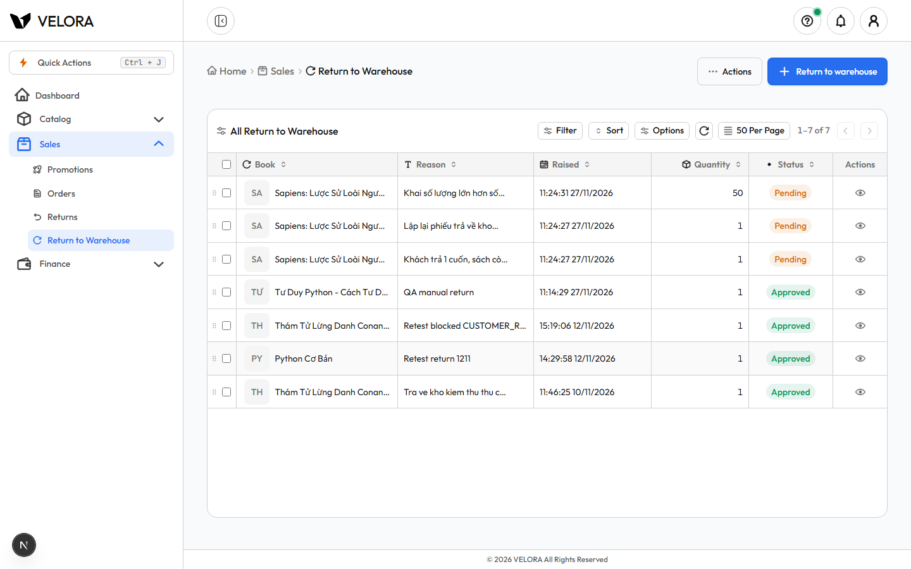

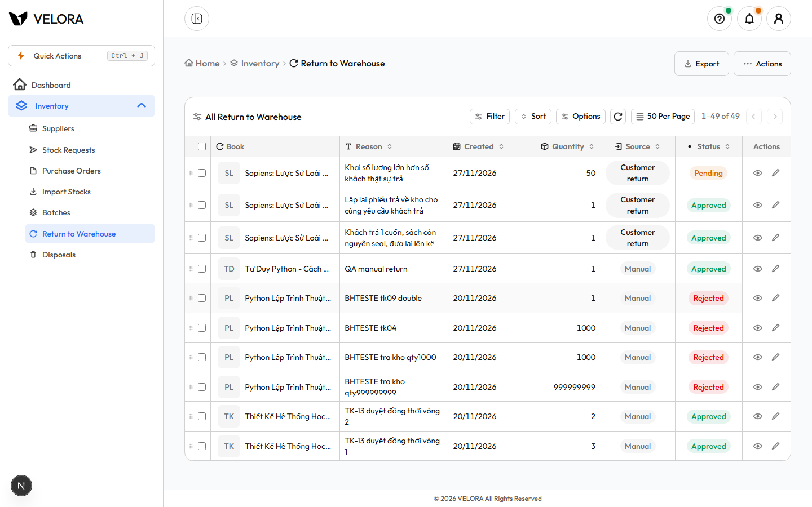

## B02

**Mã khuyến mãi chỉ còn 1 lượt nhưng 2 khách đặt cùng lúc đều được giảm**

| Trường | Nội dung |
|---|---|
| **Mức độ** | Major |
| **Trạng thái** | Chưa sửa. Phát hiện ngày 2026-11-27 khi test theo Guide me. |
| **Bug liên quan** | Trùng [SF-38](../storefront/loi.md#sf-38): ngày 2026-11-27 vẫn còn lỗi |
| **Loại** | Lỗi chức năng |
| **Luồng** | Khuyến mãi · Checkout |
| **Endpoint / Màn hình** | POST /api/v1/orders (kèm promotionId) |
| **Nghi ngờ thuộc** | order-service, promotion-service |
| **Case** | GM05-12 |
| **Bước tái hiện** | 1. Seller tạo MOBANSOM (10%, 1 lượt), Admin duyệt 2. Hai khách (Nguyễn Minh Anh, Lê Quốc Bảo) đặt đơn COD dùng mã gần như cùng lúc |
| **Mong đợi** | Chỉ một đơn được giảm; đơn còn lại bị từ chối hoặc không được giảm |
| **Thực tế** | Cả hai đơn ORD-20261127-000190 và ORD-20261127-000191 đều CONFIRMED, mỗi đơn giảm 18.900đ; lượt dùng còn 0. Lượt dùng chỉ ghi khi đơn xác nhận và lỗi ghi bị bỏ qua (best effort) |
| **API Response** | <pre>POST /api/v1/orders Request body: {   "items": [     {       "bookId": 67,       "variantId": 1,       "quantity": 1     }   ],   "addressId": 58,   "paymentMethod": "COD",   "promotionId": 170 } HTTP 201 {   "success": true,   "data": {     "id": 186,     "orderCode": "ORD-20261127-000190",     "userId": 176,     "addressId": 58,     "recipientName": "Nguyễn Minh Anh",     "recipientPhone": "0903456721",     "shippingAddress": "48 Nguyễn Thị Minh Khai, Phường Bến Thành, Quận 1, TP. Hồ Chí Minh", … (rút gọn)</pre> [Đầy đủ](api/GM05-12.txt) |
| **Ảnh bằng chứng** | [GM05-12: ảnh 1](images/GM05-12-1.png) [GM05-12: ảnh 2](images/GM05-12-2.png) [GM05-12: ảnh 3](images/GM05-12-3.png) |

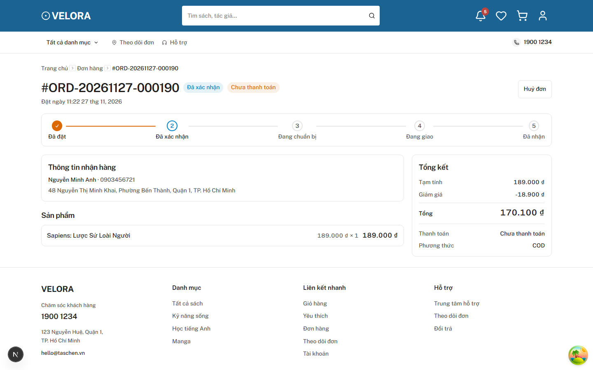

## B03

**Trang chủ storefront sập hoàn toàn khi một sách có ảnh bìa từ host không khai báo**

| Trường | Nội dung |
|---|---|
| **Mức độ** | Major |
| **Trạng thái** | Chưa sửa. Phát hiện ngày 2026-11-27 khi test theo Guide me. |
| **Loại** | Lỗi chức năng |
| **Luồng** | Storefront · Trang chủ |
| **Endpoint / Màn hình** | GET /vi (storefront) · POST /api/v1/books (imageUrl tự do) |
| **Nghi ngờ thuộc** | taschen-storefront (next/image), catalog-service (không kiểm host của imageUrl) |
| **Case** | GM13-03 |
| **Bước tái hiện** | 1. Có một sách với imageUrl https://x.test/qa.png (sách id 61 "QA-BOOK-20261127", không do đợt này tạo) 2. Mở trang chủ storefront (đăng nhập hay không đều vậy) |
| **Mong đợi** | Trang chủ hiển thị bình thường; ảnh lỗi chỉ ảnh hưởng ô của sách đó |
| **Thực tế** | Toàn bộ trang chủ báo "Something broke on our end". next/image: Invalid src prop ... hostname "x.test" is not configured. API tạo sách chấp nhận mọi URL ảnh |
| **API Response** | <pre>GET /api/v1/banners HTTP 200 {   "success": true,   "data": [     {       "id": 1,       "name": "[GM-TEST-11271102] Sale tháng 12",       "imageUrl": "https://pub-51c65cc9b6514e65ab4891a65fc437cf.r2.dev/images/dbca62fc-9090-4523-b4d8-dbf533c72e5b.webp"     }   ],   "message": "OK",   "timestamp": "2026-11-27T04:32:03.982210200Z" }  GET /api/v1/books/61 HTTP 200 {   "success": true,   "data": {     "id": 61,     "slug": "qa-book-20261127",     "title": "QA-BOOK-20261127",     "author": "QA Author",     "description": "QA", … (rút gọn)</pre> [Đầy đủ](api/GM13-03.txt) |
| **Ảnh bằng chứng** | [GM13-03: ảnh 1](images/GM13-03-1.png) [GM13-03: ảnh 2](images/GM13-03-2.png) |

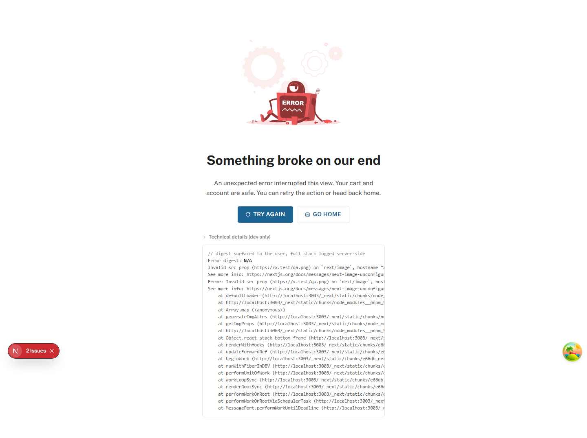

## B04

**Tồn kho ban đầu nhập ở phiên bản hiện "còn 10" trên storefront nhưng không có hàng thật**

| Trường | Nội dung |
|---|---|
| **Mức độ** | Major |
| **Trạng thái** | Chưa sửa. Phát hiện ngày 2026-11-27 khi test theo Guide me. |
| **Bug liên quan** | Gần giống [SF-35](../storefront/loi.md#sf-35) (tồn hiển thị sai), nhưng SF-35 nghi do cache |
| **Loại** | Lỗi chức năng |
| **Luồng** | Phiên bản &amp; giá → Storefront |
| **Endpoint / Màn hình** | POST /api/v1/book-variants (stockQuantity) · POST /api/v1/orders |
| **Nghi ngờ thuộc** | catalog-service (book_variants.stock_quantity tách khỏi inventory) |
| **Case** | GM03-02 |
| **Bước tái hiện** | 1. Seller thêm phiên bản Bìa cứng với tồn ban đầu 10 cho một sách chưa nhập kho 2. Khách xem trang chi tiết và đặt 1 cuốn |
| **Mong đợi** | Storefront không hiện hàng khi kho (inventory) chưa có lô, hoặc ô tồn ban đầu không tồn tại |
| **Thực tế** | Trang chi tiết ghi "Bìa cứng · còn 10", thêm giỏ được (200) nhưng đặt hàng trả 409 "Not enough stock". Inventory báo tổng 0 |
| **API Response** | <pre>GET /api/v1/books/60 HTTP 200 {   "success": true,   "data": {     "id": 60,     "slug": "gm-test-11271102-sach-ton-ao",     "title": "[GM-TEST-11271102] Sách tồn ảo",     "author": "GM Tác giả",     "description": "Sách test của đợt GM-TEST-11271102",     "publicationYear": 2020,     "weightGrams": null,     "pageCount": 227,     "price": 30000.0,     "stockQuantity": 0,     "imageUrl": "https://pub-51c65cc9b6514e65ab4891a65fc437cf.r2.dev/images/dbca62fc-9090-4523-b4d8-dbf533c72e5b.webp",     "isActive": true,     "deletedAt": null,     "deletedBy": null,     "variantFormats": [       {         "variantId": 1,         "formatCode": "BIA_MEM",         "formatName": "Bìa mềm",         "price": 79000.0, … (rút gọn)</pre> [Đầy đủ](api/GM03-02.txt) |
| **Ảnh bằng chứng** | [GM03-02: ảnh 1](images/GM03-02-1.png) [GM03-02: ảnh 2](images/GM03-02-2.png) |

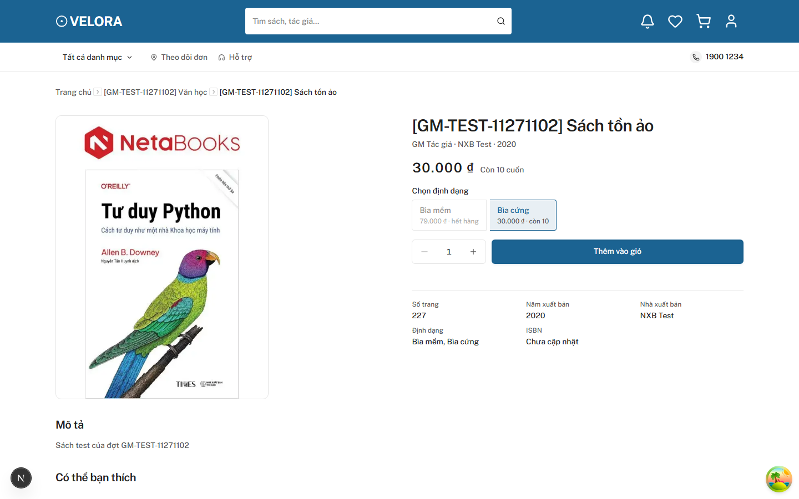

## B05

**Giá nhập bằng 0 gây lỗi 500 thay vì báo lỗi kiểm tra**

| Trường | Nội dung |
|---|---|
| **Mức độ** | Major |
| **Trạng thái** | Chưa sửa. Phát hiện ngày 2026-11-27 khi test theo Guide me. |
| **Loại** | Lỗi chức năng |
| **Luồng** | Đơn mua |
| **Endpoint / Màn hình** | POST /api/v1/purchase-orders/from-stock-request |
| **Nghi ngờ thuộc** | inventory-service |
| **Case** | GM09-12 |
| **Bước tái hiện** | 1. Yêu cầu nhập đã duyệt 2. Lên đơn mua với importPrice = 0 |
| **Mong đợi** | 400 với thông báo rõ (hoặc chấp nhận nếu nghiệp vụ cho phép) |
| **Thực tế** | 500 INTERNAL_ERROR. Log: request cho phép &gt;= 0 nhưng entity PurchaseOrderItem yêu cầu &gt; 0, lỗi bung ra lúc lưu DB |
| **API Response** | <pre>POST /api/v1/purchase-orders/from-stock-request Request body: {   "stockRequestId": 17,   "supplierId": 36,   "importPrice": 0,   "note": "Hàng tặng kèm" } HTTP 500 {   "success": false,   "code": "INTERNAL_ERROR",   "message": "Something went wrong. Please try again later.",   "traceId": "4c8cdc087e0b44ff",   "path": "/api/v1/purchase-orders/from-stock-request",   "timestamp": "2026-11-27T04:20:08.952190200Z" }  POST /api/v1/purchase-orders/from-stock-request Request body: {   "stockRequestId": 17,   "supplierId": 36,   "importPrice": 1,   "note": "Hàng tặng kèm" … (rút gọn)</pre> [Đầy đủ](api/GM09-12.txt) |
| **Ảnh bằng chứng** | [GM09-12: ảnh 1](images/GM09-12-1.png) |
| **Log máy chủ** | [GM09-12](api/GM09-12-server-log.txt) |

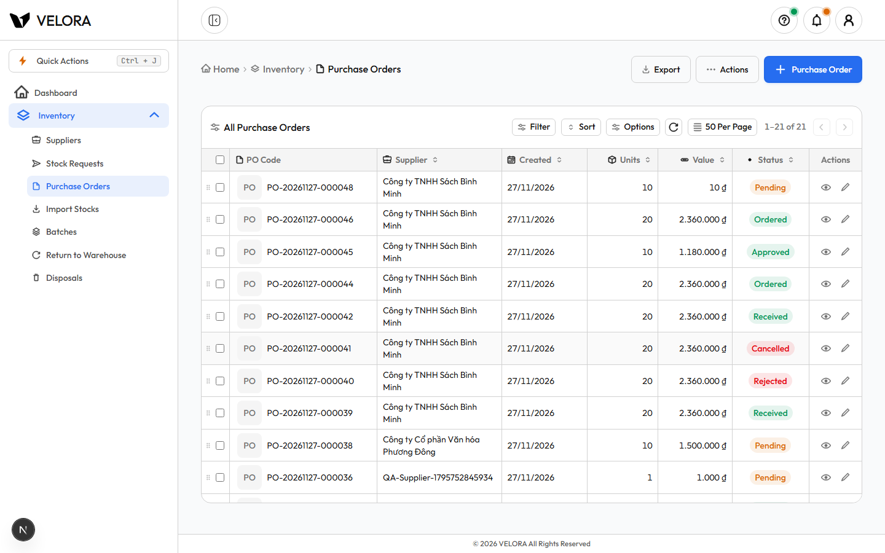

## B06

**Tạo được đơn mua với nhà cung cấp đã ngừng hoạt động (qua API)**

| Trường | Nội dung |
|---|---|
| **Mức độ** | Major |
| **Trạng thái** | Chưa sửa. Phát hiện ngày 2026-11-27 khi test theo Guide me. |
| **Loại** | Lỗi chức năng |
| **Luồng** | Nhà cung cấp → Đơn mua |
| **Endpoint / Màn hình** | POST /api/v1/purchase-orders |
| **Nghi ngờ thuộc** | inventory-service |
| **Case** | GM07-03 |
| **Bước tái hiện** | 1. Admin ngừng hoạt động "Công ty Cổ phần Văn hóa Phương Đông" 2. Gọi tạo đơn mua với supplierId đó |
| **Mong đợi** | Bị từ chối (nhà cung cấp ngừng hoạt động không dùng được) |
| **Thực tế** | 201, đơn mua được tạo. Giao diện ẩn nhà cung cấp khỏi danh sách chọn nhưng API không kiểm |
| **API Response** | <pre>DELETE /api/v1/suppliers/38 HTTP 204 {}  POST /api/v1/purchase-orders Request body: {   "supplierId": 38,   "note": "Đặt bổ sung tháng 12",   "items": [     {       "bookId": 1,       "variantId": 1,       "quantity": 10,       "importPrice": 150000     }   ] } HTTP 201 {   "success": true,   "data": {     "id": 14,     "poCode": "PO-20261127-000038",     "createdAt": "2026-11-27T04:16:36.490948900Z", … (rút gọn)</pre> [Đầy đủ](api/GM07-03.txt) |
| **Ảnh bằng chứng** | [GM07-03: ảnh 1](images/GM07-03-1.png) |

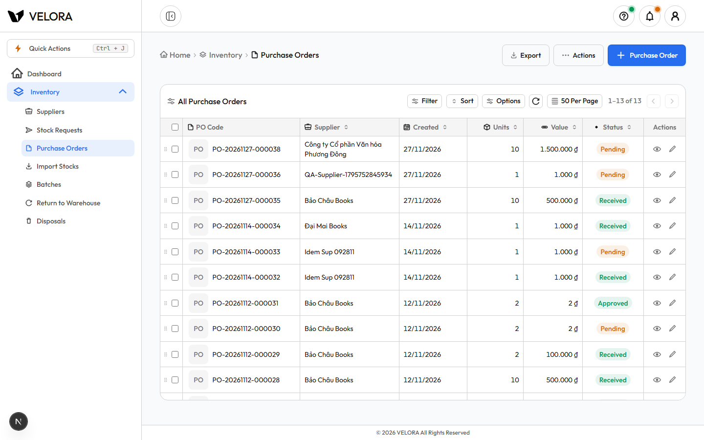

## B07

**Duyệt trả về kho cho sách chưa có lô: phiếu báo APPROVED nhưng hàng không vào kho, không có lỗi**

| Trường | Nội dung |
|---|---|
| **Mức độ** | Major |
| **Trạng thái** | Chưa sửa. Phát hiện ngày 2026-11-27 khi test theo Guide me. |
| **Loại** | Lỗi chức năng |
| **Luồng** | Duyệt trả về kho |
| **Endpoint / Màn hình** | PATCH /api/v1/inventory/return-to-warehouse/{id}/approve |
| **Nghi ngờ thuộc** | inventory-service (BatchServiceImpl.restockReturnedUnits) |
| **Case** | GM11-03 |
| **Bước tái hiện** | 1. Seller lập phiếu trả về kho 1 cuốn "Tuổi Trẻ Đáng Giá Bao Nhiêu" (chưa từng nhập lô) 2. Warehouse duyệt |
| **Mong đợi** | Báo lỗi hoặc tạo lô mới; không được báo thành công khi tồn không đổi |
| **Thực tế** | 200 APPROVED, tồn kho sau duyệt vẫn 0 (code chỉ ghi log cảnh báo rồi bỏ qua) |
| **API Response** | <pre>POST /api/v1/inventory/return-to-warehouse Request body: {   "reason": "Khách trả cuốn sách chưa từng nhập kho qua phiếu nhập",   "items": [     {       "bookId": 70,       "variantId": 1,       "quantity": 1     }   ],   "returnRequestId": 64 } HTTP 201 {   "success": true,   "data": {     "id": 50,     "returnCode": "RTW-20261127-000069",     "reason": "Khách trả cuốn sách chưa từng nhập kho qua phiếu nhập",     "responseNote": null,     "status": "PENDING",     "source": "CUSTOMER_RETURN",     "createdAt": "2026-11-27T04:24:52.726531700Z",     "processedAt": null, … (rút gọn)</pre> [Đầy đủ](api/GM11-03.txt) |
| **Ảnh bằng chứng** | [GM11-03: ảnh 1](images/GM11-03-1.png) |

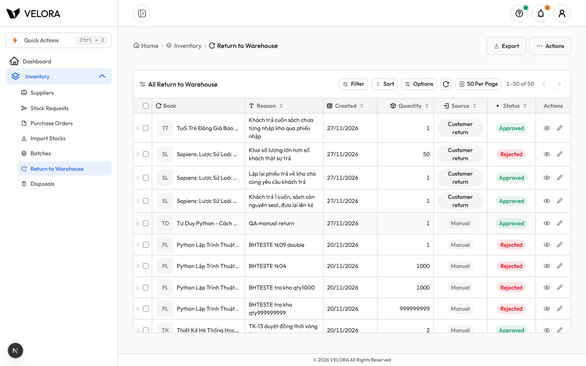

## B08

**Mã danh mục và mã khuyến mãi nhận chữ thường và dấu cách, trái với hướng dẫn**

| Trường | Nội dung |
|---|---|
| **Mức độ** | Minor |
| **Trạng thái** | Chưa sửa. Phát hiện ngày 2026-11-27 khi test theo Guide me. |
| **Bug liên quan** | Trùng một phần [BO-08](../backoffice/loi.md#bo-08) (mã khuyến mãi); phần mã danh mục là mới |
| **Loại** | Lỗi chức năng |
| **Luồng** | Danh mục · Khuyến mãi |
| **Endpoint / Màn hình** | POST /api/v1/categories · POST /api/v1/promotions |
| **Nghi ngờ thuộc** | catalog-service, promotion-service |
| **Case** | GM01-06, GM05-06 |
| **Bước tái hiện** | 1. Tạo danh mục mã "gm 11271102 ky nang" 2. Tạo khuyến mãi mã "tet dinh mui", Admin duyệt, khách nhập đúng chuỗi |
| **Mong đợi** | Bị chặn hoặc tự chuẩn hoá (viết hoa, bỏ dấu cách) như Guide me yêu cầu |
| **Thực tế** | Cả hai được lưu nguyên văn (201); mã khuyến mãi có dấu cách vẫn dùng được |
| **API Response** | <pre>POST /api/v1/categories Request body: {   "name": "[GM-TEST-11271102] Kỹ năng sống",   "code": "gm 11271102 ky nang" } HTTP 201 {   "success": true,   "data": {     "id": 10,     "slug": "gm-test-11271102-ky-nang-song",     "code": "gm 11271102 ky nang",     "name": "[GM-TEST-11271102] Kỹ năng sống"   },   "message": "Category created",   "timestamp": "2026-11-27T04:06:54.645863200Z" }</pre> [Đầy đủ](api/GM01-06.txt)<pre>POST /api/v1/promotions Request body: {   "name": "Tết Đinh Mùi",   "code": "tet dinh mui",   "discountPercent": 10,   "quantity": 50,   "priceOrderActive": 200000,   "startDate": "2026-11-27",   "endDate": "2026-12-02" } HTTP 201 {   "success": true,   "data": {     "id": 167,     "name": "Tết Đinh Mùi",     "code": "tet dinh mui",     "discountPercent": 10,     "startDate": "2026-11-27",     "endDate": "2026-12-02",     "quantity": 50,     "isActive": true,     "status": "PENDING",     "priceOrderActive": 200000, … (rút gọn)</pre> [Đầy đủ](api/GM05-06.txt) |
| **Ảnh bằng chứng** | [GM01-06: ảnh 1](images/GM01-06-1.png) [GM05-06: ảnh 1](images/GM05-06-1.png) |

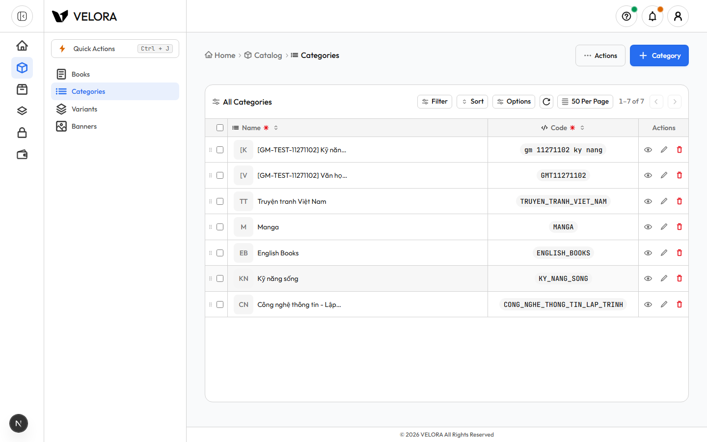

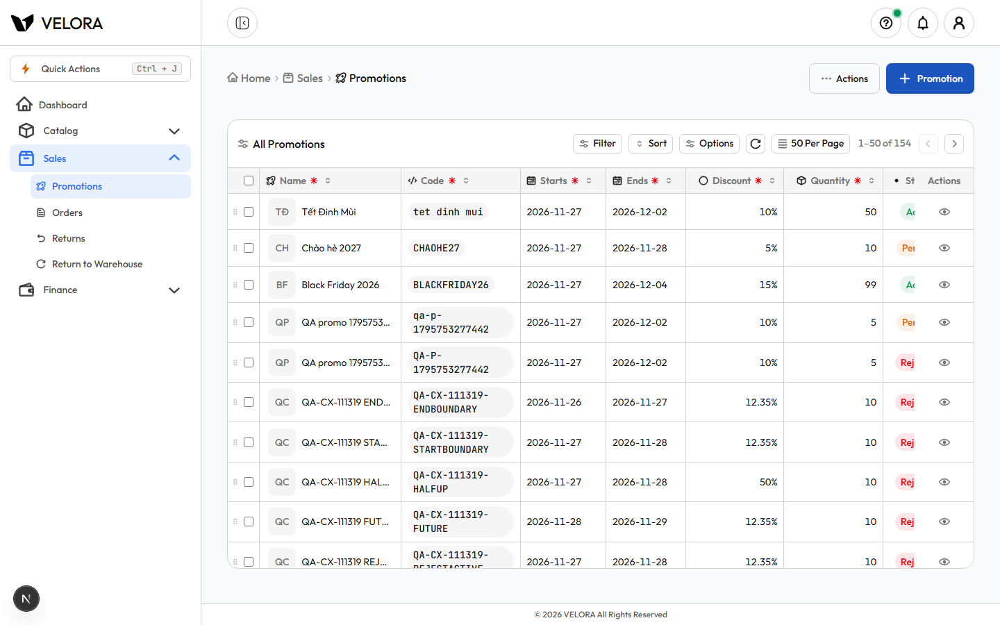

## B09

**Guide me nói banner có nút bật/tắt và đường dẫn, nhưng form không có**

| Trường | Nội dung |
|---|---|
| **Mức độ** | Minor |
| **Trạng thái** | Chưa sửa. Phát hiện ngày 2026-11-27 khi test theo Guide me. |
| **Loại** | Nội dung Guide me |
| **Luồng** | Guide me: Đăng banner |
| **Endpoint / Màn hình** | (giao diện) form banner · BannerRequest |
| **Nghi ngờ thuộc** | taschen-backoffice (guide seller), catalog-service |
| **Case** | GM04-02 |
| **Bước tái hiện** | Mở form banner (Admin trong ứng dụng Seller) |
| **Mong đợi** | Form có bật/tắt và ô đường dẫn như bước Lưu mô tả |
| **Thực tế** | Form chỉ có Name và Image URL; API cũng chỉ có name, imageUrl |
| **API Response** | <pre>GET /api/v1/banners/1 HTTP 200 {   "success": true,   "data": {     "id": 1,     "name": "[GM-TEST-11271102] Sale tháng 12",     "imageUrl": "https://pub-51c65cc9b6514e65ab4891a65fc437cf.r2.dev/images/dbca62fc-9090-4523-b4d8-dbf533c72e5b.webp"   },   "message": "OK",   "timestamp": "2026-11-27T04:37:46.077658900Z" }  Ghi chú: bản ghi banner chỉ có các trường trên; không có trường bật/tắt hay đường dẫn.</pre> [Đầy đủ](api/GM04-02.txt) |
| **Ảnh bằng chứng** | [GM04-02: ảnh 1](images/GM04-02-1.png) [GM04-02: ảnh 2](images/GM04-02-2.png) [GM04-02: ảnh 3](images/GM04-02-3.png) |

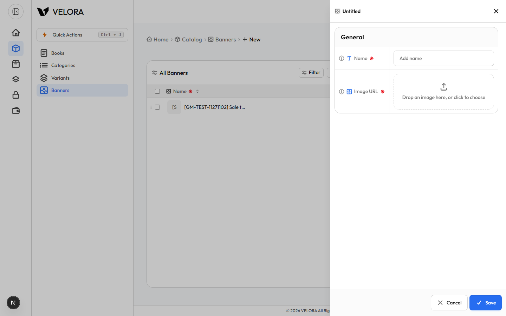

## B10

**Tip số lượt ngụ ý được tạo khuyến mãi không giới hạn, nhưng hệ thống bắt buộc số lượt**

| Trường | Nội dung |
|---|---|
| **Mức độ** | Minor |
| **Trạng thái** | Chưa sửa. Phát hiện ngày 2026-11-27 khi test theo Guide me. |
| **Loại** | Nội dung Guide me |
| **Luồng** | Guide me: Tạo khuyến mãi |
| **Endpoint / Màn hình** | POST /api/v1/promotions (quantity trống) |
| **Nghi ngờ thuộc** | taschen-backoffice (guide seller) |
| **Case** | GM05-05 |
| **Bước tái hiện** | Bỏ trống số lượt khi tạo khuyến mãi |
| **Mong đợi** | Lời hướng dẫn khớp với hệ thống |
| **Thực tế** | 400 Quantity is required |
| **API Response** | <pre>POST /api/v1/promotions Request body: {   "name": "Tri ân khách hàng",   "code": "TRIAN2026",   "discountPercent": 5,   "priceOrderActive": 200000,   "startDate": "2026-11-27",   "endDate": "2026-11-28" } HTTP 400 {   "success": false,   "code": "VALIDATION_ERROR",   "message": "The request contains invalid data.",   "traceId": "271f8da2-5c21-440c-acf0-01a1f8f10a6c",   "path": "/api/v1/promotions",   "timestamp": "2026-11-27T04:21:48.600274400Z",   "fieldErrors": {     "quantity": "Quantity is required"   } }</pre> [Đầy đủ](api/GM05-05.txt) |
| **Ảnh bằng chứng** | [GM05-05: ảnh 1](images/GM05-05-1.png) [GM05-05: ảnh 2](images/GM05-05-2.png) |

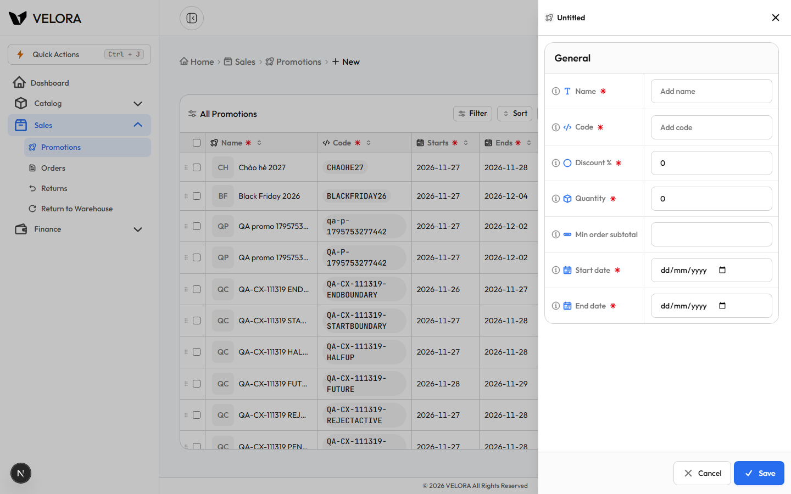

## B11

**Guide me nói từ chối thì đơn đóng lại, nhưng khách vẫn gửi được yêu cầu mới**

| Trường | Nội dung |
|---|---|
| **Mức độ** | Minor |
| **Trạng thái** | Chưa sửa. Phát hiện ngày 2026-11-27 khi test theo Guide me. |
| **Loại** | Nội dung Guide me |
| **Luồng** | Guide me: Xử lý trả hàng |
| **Endpoint / Màn hình** | POST /api/v1/returns |
| **Nghi ngờ thuộc** | order-service hoặc nội dung guide |
| **Case** | GM06-03 |
| **Bước tái hiện** | 1. Seller từ chối yêu cầu trả của đơn ORD-... 2. Khách tạo yêu cầu mới cho cùng đơn (còn trong 7 ngày) |
| **Mong đợi** | Lời hướng dẫn khớp hành vi (hoặc hệ thống chặn) |
| **Thực tế** | 201, yêu cầu mới RMA-20261127-000066 |
| **API Response** | <pre>POST /api/v1/returns Request body: {   "orderId": 188,   "reasonCode": "WRONG_ITEM",   "description": "Gửi lại yêu cầu kèm ảnh tem đơn hàng ghi bản bìa cứng như đã đặt",   "items": [     {       "orderDetailId": 206,       "quantity": 1     }   ],   "evidenceUrls": [     "https://pub-51c65cc9b6514e65ab4891a65fc437cf.r2.dev/images/dbca62fc-9090-4523-b4d8-dbf533c72e5b.webp"   ],   "refundDestination": {     "type": "EWALLET",     "provider": "MoMo",     "accountNumber": "0938127456",     "accountHolder": "LE QUOC BAO"   } } HTTP 201 {   "success": true, … (rút gọn)</pre> [Đầy đủ](api/GM06-03.txt) |
| **Ảnh bằng chứng** | [GM06-03: ảnh 1](images/GM06-03-1.png) |

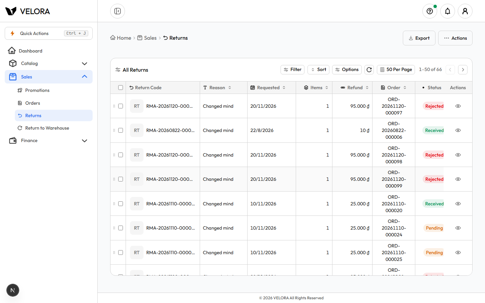

## B12

**Guide me nói bấm Đã nhận thì "tiền đã hoàn", thực tế chỉ mở khoản hoàn chờ chi**

| Trường | Nội dung |
|---|---|
| **Mức độ** | Minor |
| **Trạng thái** | Chưa sửa. Phát hiện ngày 2026-11-27 khi test theo Guide me. |
| **Loại** | Nội dung Guide me |
| **Luồng** | Guide me: Xử lý trả hàng |
| **Endpoint / Màn hình** | PATCH /api/v1/returns/{id}/received |
| **Nghi ngờ thuộc** | taschen-backoffice (guide seller) |
| **Case** | GM06-04 |
| **Bước tái hiện** | Seller bấm Đã nhận cho yêu cầu đã duyệt |
| **Mong đợi** | Lời hướng dẫn nói rõ còn bước chi trả |
| **Thực tế** | Đơn REFUND_PENDING, khoản hoàn RFD-20261127-000012 OPEN 160.650đ, chưa chi |
| **API Response** | <pre>PATCH /api/v1/returns/64/received HTTP 200 {   "success": true,   "data": {     "id": 64,     "returnCode": "RMA-20261127-000064",     "orderId": 184,     "reasonCode": "DEFECTIVE",     "description": "Sách bị rách gáy và bong trang 45 đến 60 ngay khi mở hộp nhận hàng",     "responseNote": "Đồng ý nhận lại, vui lòng gửi hàng về kho Quận 7",     "status": "RECEIVED",     "refundAmount": 160650.0,     "items": [       {         "orderDetailId": 202,         "bookId": 67,         "bookTitle": "Sapiens: Lược Sử Loài Người",         "unitPrice": 189000.0,         "quantity": 1,         "lineRefund": 189000.0       }     ],     "evidenceUrls": [       "https://pub-51c65cc9b6514e65ab4891a65fc437cf.r2.dev/images/dbca62fc-9090-4523-b4d8-dbf533c72e5b.webp" … (rút gọn)</pre> [Đầy đủ](api/GM06-04.txt) |
| **Ảnh bằng chứng** | [GM06-04: ảnh 1](images/GM06-04-1.png) |

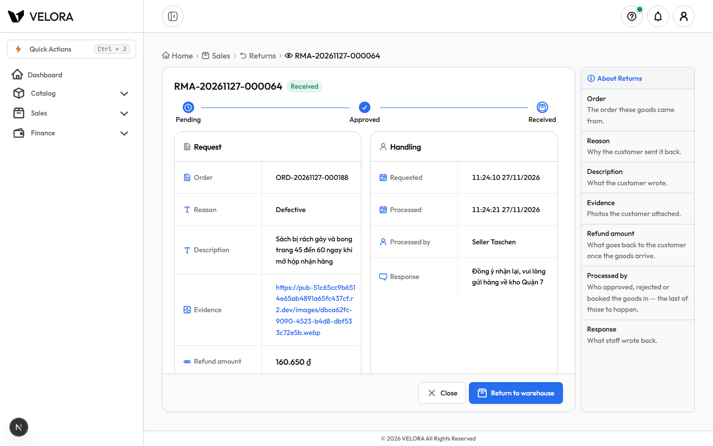

## B13

**Guide me nói Admin quyết số lượng cuối cùng, nhưng không có chỗ sửa số lượng khi duyệt**

| Trường | Nội dung |
|---|---|
| **Mức độ** | Minor |
| **Trạng thái** | Chưa sửa. Phát hiện ngày 2026-11-27 khi test theo Guide me. |
| **Loại** | Nội dung Guide me |
| **Luồng** | Guide me: Yêu cầu nhập hàng |
| **Endpoint / Màn hình** | PATCH /api/v1/inventory/stock-requests/{id}/approve |
| **Nghi ngờ thuộc** | inventory-service, taschen-backoffice |
| **Case** | GM08-03 |
| **Bước tái hiện** | Admin mở hộp thoại duyệt yêu cầu nhập; thử gửi quantity qua API |
| **Mong đợi** | Có ô sửa số lượng, hoặc sửa lời hướng dẫn |
| **Thực tế** | Hộp thoại chỉ có lời nhắn; API bỏ qua quantity |
| **API Response** | <pre>PATCH /api/v1/inventory/stock-requests/10/approve Request body: {   "quantity": 3,   "responseMessage": "Chỉ duyệt 3 cuốn" } HTTP 200 {   "success": true,   "data": {     "id": 10,     "requestCode": "STK-20261127-000026",     "quantity": 6,     "reason": "Còn 2 cuốn trên kệ, mỗi tuần bán khoảng 5 cuốn",     "status": "APPROVED",     "createdAt": "2026-11-27T04:18:27.017932Z",     "processedAt": "2026-11-27T04:37:46.166329100Z",     "responseMessage": "Chỉ duyệt 3 cuốn",     "bookId": 67,     "bookTitle": null,     "variantId": 1,     "createdByUserId": 97,     "processedByUserId": 95,     "createdBy": "Warehouse Taschen",     "processedBy": "Admin Taschen" … (rút gọn)</pre> [Đầy đủ](api/GM08-03.txt) |
| **Ảnh bằng chứng** | [GM08-03: ảnh 1](images/GM08-03-1.png) [GM08-03: ảnh 2](images/GM08-03-2.png) |

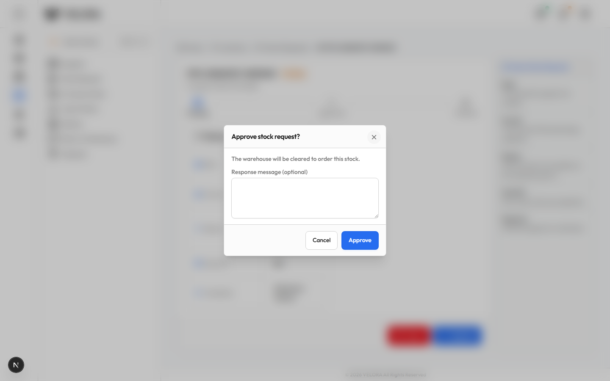

## B14

**Guide me mô tả trạng thái cuối "Đã nhận" cho yêu cầu nhập, hệ thống không có trạng thái này**

| Trường | Nội dung |
|---|---|
| **Mức độ** | Minor |
| **Trạng thái** | Chưa sửa. Phát hiện ngày 2026-11-27 khi test theo Guide me. |
| **Loại** | Nội dung Guide me |
| **Luồng** | Guide me: Yêu cầu nhập hàng |
| **Endpoint / Màn hình** | GET /api/v1/inventory/stock-requests/{id} |
| **Nghi ngờ thuộc** | inventory-service hoặc guide warehouse |
| **Case** | GM08-04 |
| **Bước tái hiện** | Theo dõi yêu cầu nhập sau khi đơn mua đã nhận đủ |
| **Mong đợi** | Yêu cầu chuyển Đã nhận, hoặc sửa lời hướng dẫn |
| **Thực tế** | Yêu cầu dừng ở ORDERED dù đơn mua RECEIVED |
| **API Response** | <pre>GET /api/v1/inventory/stock-requests/6 HTTP 200 {   "success": true,   "data": {     "id": 6,     "requestCode": "STK-20261127-000022",     "quantity": 20,     "reason": "Còn 2 cuốn trên kệ, mỗi tuần bán khoảng 5 cuốn",     "status": "ORDERED",     "createdAt": "2026-11-27T04:18:10.834603Z",     "processedAt": "2026-11-27T04:18:11.333682Z",     "responseMessage": "Đồng ý nhập 20 cuốn cho đợt cuối năm",     "bookId": 67,     "bookTitle": null,     "variantId": 1,     "createdByUserId": 97,     "processedByUserId": 95,     "createdBy": "Warehouse Taschen",     "processedBy": "Admin Taschen"   },   "message": "OK",   "timestamp": "2026-11-27T04:19:59.140488800Z" }  … (rút gọn)</pre> [Đầy đủ](api/GM08-04.txt) |
| **Ảnh bằng chứng** | [GM08-04: ảnh 1](images/GM08-04-1.png) |

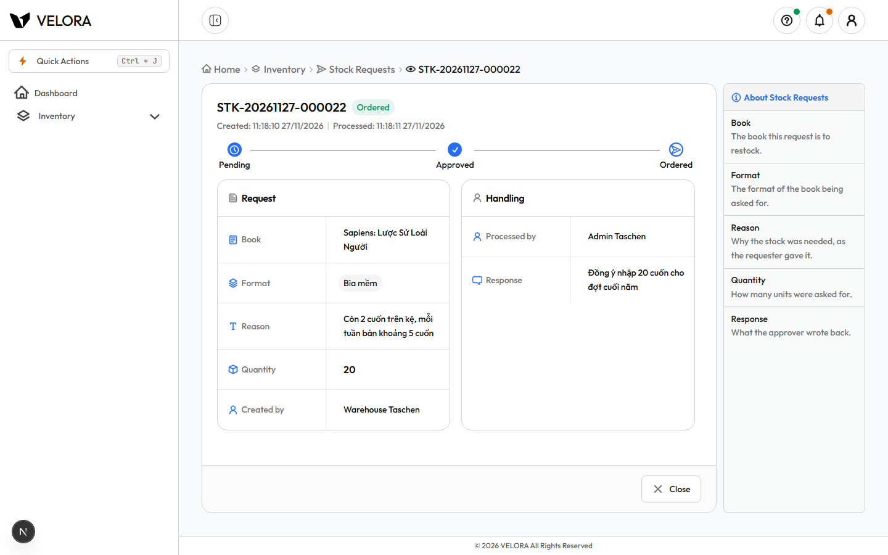

## B15

**Guide me bước duyệt nói duyệt xong là nhận hàng được, thực tế phải qua bước Thanh toán**

| Trường | Nội dung |
|---|---|
| **Mức độ** | Minor |
| **Trạng thái** | Chưa sửa. Phát hiện ngày 2026-11-27 khi test theo Guide me. |
| **Loại** | Nội dung Guide me |
| **Luồng** | Guide me: Đơn mua |
| **Endpoint / Màn hình** | POST /api/v1/inventory/import-stocks |
| **Nghi ngờ thuộc** | taschen-backoffice (guide warehouse) |
| **Case** | GM09-03 |
| **Bước tái hiện** | Admin duyệt đơn mua rồi Warehouse lập phiếu nhập ngay |
| **Mong đợi** | Lời hướng dẫn khớp quy trình |
| **Thực tế** | 409: đơn phải ORDERED mới nhận hàng được (hệ thống đúng, lời hướng dẫn sai) |
| **API Response** | <pre>POST /api/v1/inventory/import-stocks Request body: {   "supplierId": 36,   "purchaseOrderId": 15,   "details": [     {       "bookId": 67,       "variantId": 1,       "supplierId": 36,       "quantity": 20,       "importPrice": 118000     }   ] } HTTP 409 {   "success": false,   "code": "CONFLICT",   "message": "The request conflicts with the current state of the resource.",   "traceId": "8488e8e1bbc649e7",   "path": "/api/v1/inventory/import-stocks",   "timestamp": "2026-11-27T04:18:28.354186400Z" }</pre> [Đầy đủ](api/GM09-03.txt) |
| **Ảnh bằng chứng** | [GM09-03: ảnh 1](images/GM09-03-1.png) |

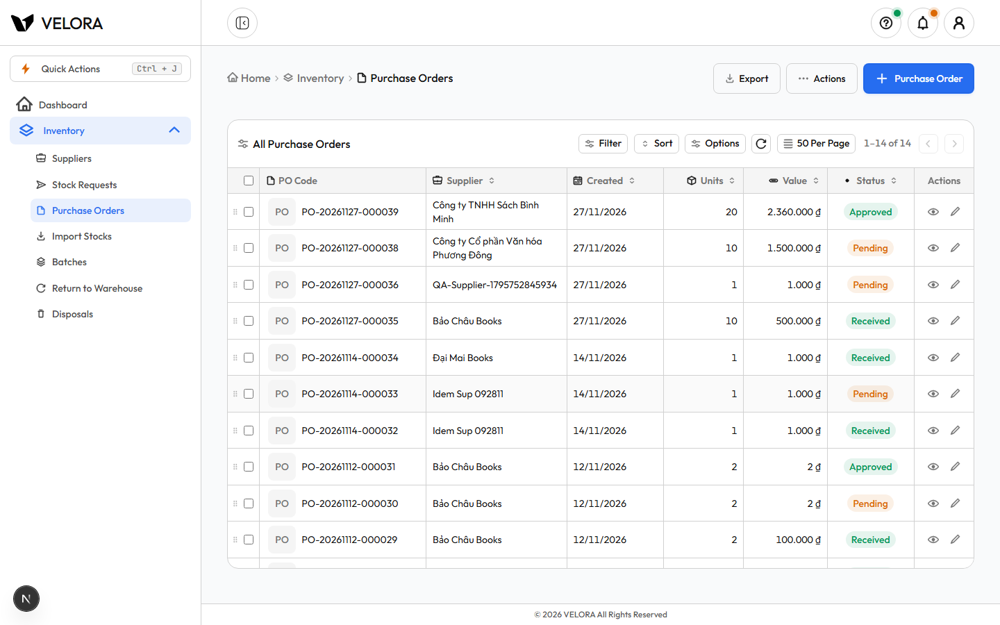
