# Retest ngày 2026-11-27

[← Đợt test 2026-11-27](../README.md)

Chạy lại 19 lỗi ở nhóm **Chờ retest** của [bảng trạng thái](../../trang-thai.md), trên backend `d5b6ac2`, storefront `0a72cc4`, backoffice `8e1ecfbe` (cùng bản với đợt test 27/11), local nối DB và broker dùng chung. Giao diện chạy bằng Playwright (Chromium) có quay video, phần API gọi qua gateway. SF-30 chạy với gateway bật `APP_RATE_LIMIT_ENABLED=true` vì profile dev tắt giới hạn.

| Kết quả | Số lỗi |
| --- | --- |
| Đã xác nhận | 15 |
| Xác nhận một phần | 3 |
| Còn lỗi | 1 |

Đã xác nhận chuyển sang **Đã đóng**. Xác nhận một phần và Còn lỗi chuyển về **Cần sửa** với phần còn thiếu.

| Mã | Mức độ | Lỗi | Kết quả |
| --- | --- | --- | --- |
| [BO-12](#bo-12) | Minor | Điều hướng Admin làm mất tiền tố /admin, mất phiên | Đã xác nhận |
| [SF-03](#sf-03) | Major | order-service không ghi log khi trả lỗi | Đã xác nhận |
| [SF-11](#sf-11) | Minor | Mọi lỗi 403 khi đăng nhập đều báo chưa xác thực email | Đã xác nhận |
| [SF-17](#sf-17) | Minor | Chi tiết sách hiện 0 trang, năm 0, 0 g | Đã xác nhận |
| [SF-18](#sf-18) | Minor | Địa chỉ dài tràn màn hình checkout | Đã xác nhận |
| [SF-19](#sf-19) | Minor | Nội dung checkout sát mép màn hình | Đã xác nhận |
| [SF-20](#sf-20) | Minor | Khung thông báo bị cắt ở điện thoại | Đã xác nhận |
| [SF-21](#sf-21) | Minor | Nút yêu thích và thêm giỏ không hiện trên cảm ứng | Đã xác nhận |
| [SF-22](#sf-22) | Minor | Chip lọc trạng thái đơn hàng hiển thị tiếng Anh | Đã xác nhận |
| [SF-23](#sf-23) | Minor | Breadcrumb chồng chữ trên điện thoại | Đã xác nhận |
| [SF-24](#sf-24) | Minor | Khách chưa đăng nhập thấy trạng thái rỗng của đơn hàng và thông báo | Đã xác nhận |
| [SF-25](#sf-25) | Minor | Menu phụ điện thoại bị chật và cắt chữ | Đã xác nhận |
| [SF-26](#sf-26) | Minor | Đường dẫn không tồn tại hiển thị trang 404 mặc định | Đã xác nhận |
| [SF-30](#sf-30) | Minor | Đăng nhập sai nhiều lần không bị giới hạn | Đã xác nhận |
| [SF-40](#sf-40) | Major | Đổi trả đồng thời tạo nhiều yêu cầu cho một cuốn | Đã xác nhận |
| [SF-04](#sf-04) | Major | notification-service không khởi động vì thiếu biến Mongo | Xác nhận một phần |
| [SF-13](#sf-13) | Minor | Giao diện hiện thương hiệu Taschen thay vì Velora | Xác nhận một phần |
| [SF-14](#sf-14) | Minor | Tiêu đề tab là Book Store và trạng thái đơn hiện mã tiếng Anh | Xác nhận một phần |
| [SF-27](#sf-27) | Minor | Nhiều trang dùng chung tiêu đề tab | Còn lỗi |

## Chi tiết

### BO-12

**Điều hướng Admin làm mất tiền tố /admin, mất phiên** · [hồ sơ lỗi](../../backoffice/loi.md#bo-12)

| Mục | Nội dung |
| --- | --- |
| Kết quả | Đã xác nhận |
| Bản sửa | backoffice PR #369 (merge `fe73d47f`, BUG-001) |
| Thực tế khi chạy lại | Danh sách → mở đơn → tải lại → mở đơn APPROVED → Mark ordered: URL giữ /admin/warehouse và phiên Admin ở mọi bước (:3001/admin/warehouse/purchase-orders \| :3001/admin/warehouse/purchase-orders/PO-20261127-000051 \| :3001/admin/warehouse/purchase-orders/PO-20261127-000051 \| :3001/admin/warehouse/purchase-orders/PO-20261127-000045 \| :3001/admin/warehouse/purchase-orders). Bấm Mark ordered cho PO-20261127-000045; trạng thái sau: ORDERED |
| Bằng chứng | [1-danh-sach](BO-12/1-danh-sach.png) · [2-mo-don](BO-12/2-mo-don.png) · [3-tai-lai](BO-12/3-tai-lai.png) · [4-sau-mark-ordered](BO-12/4-sau-mark-ordered.png) · [api-response](BO-12/api-response.txt) |

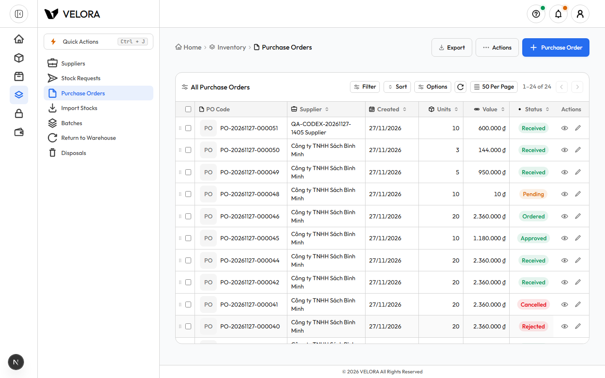

### SF-03

**order-service không ghi log khi trả lỗi** · [hồ sơ lỗi](../../storefront/loi.md#sf-03)

| Mục | Nội dung |
| --- | --- |
| Kết quả | Đã xác nhận |
| Bản sửa | backend PR #117 (`e090ed4`) |
| Thực tế khi chạy lại | GET /orders/stats/month thiếu tham số trả 500, traceId 784134ea-d654-4d2e-a237-a7d13db65480. Log order-service có 1 dòng chứa traceId kèm exception (ERROR và stack trace) |
| Bằng chứng | [api-response](SF-03/api-response.txt) |

### SF-11

**Mọi lỗi 403 khi đăng nhập đều báo chưa xác thực email** · [hồ sơ lỗi](../../storefront/loi.md#sf-11)

| Mục | Nội dung |
| --- | --- |
| Kết quả | Đã xác nhận |
| Bản sửa | storefront PR #77 (`b3444b9`) |
| Thực tế khi chạy lại | 403 thân rỗng từ gateway báo: "Không kết nối được máy chủ. Vui lòng thử lại."; tài khoản chưa xác thực thật báo: "Tài khoản này chưa xác thực email nên chưa đăng nhập được." |
| Bằng chứng | [1-gateway-403](SF-11/1-gateway-403.png) · [2-tai-khoan-chua-xac-thuc](SF-11/2-tai-khoan-chua-xac-thuc.png) · [api-response](SF-11/api-response.txt) |

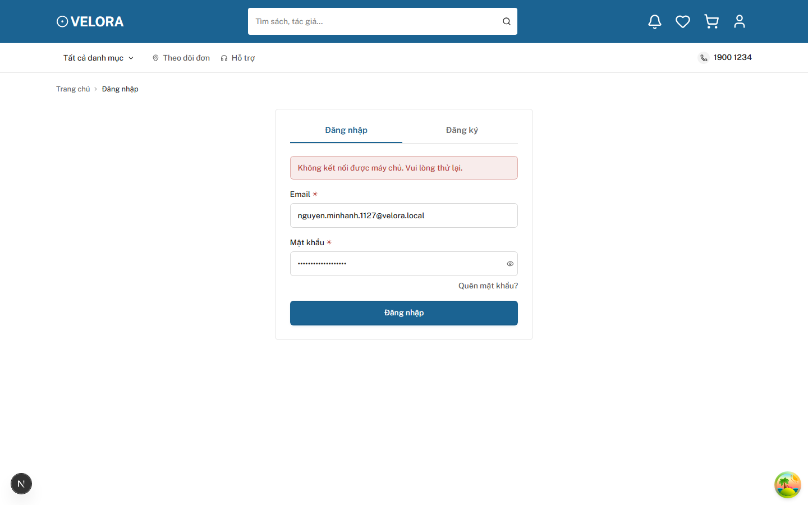

### SF-17

**Chi tiết sách hiện 0 trang, năm 0, 0 g** · [hồ sơ lỗi](../../storefront/loi.md#sf-17)

| Mục | Nội dung |
| --- | --- |
| Kết quả | Đã xác nhận |
| Bản sửa | storefront PR #77 (`b3444b9`) |
| Thực tế khi chạy lại | Sách id 10 không có số trang, năm, cân nặng: trang chi tiết không còn hiện 0 |
| Bằng chứng | [1-chi-tiet-sach](SF-17/1-chi-tiet-sach.png) · [api-response](SF-17/api-response.txt) |

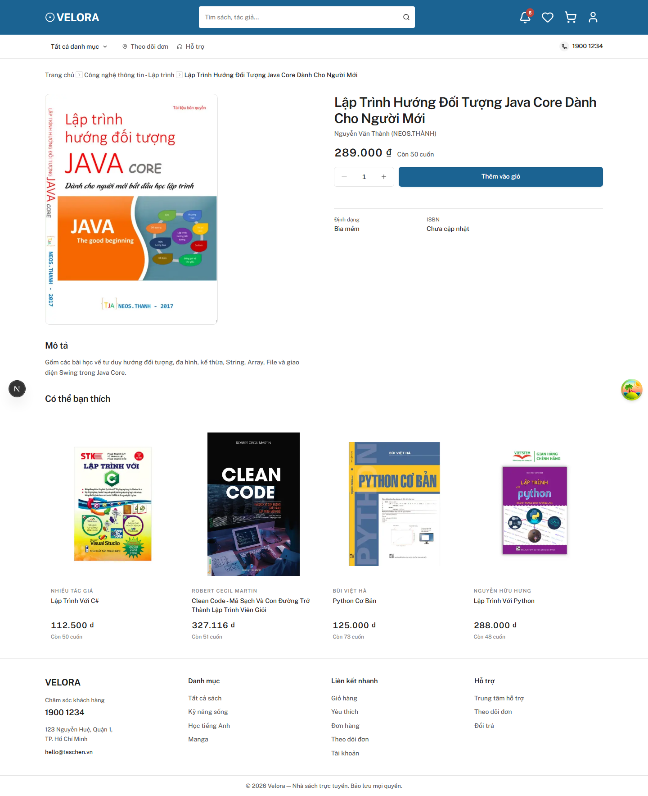

### SF-18

**Địa chỉ dài tràn màn hình checkout** · [hồ sơ lỗi](../../storefront/loi.md#sf-18)

| Mục | Nội dung |
| --- | --- |
| Kết quả | Đã xác nhận |
| Bản sửa | storefront PR #77 (`b3444b9`) |
| Thực tế khi chạy lại | Địa chỉ 172 ký tự liền (API 201); checkout 390px: scrollWidth 390 / clientWidth 390 |
| Bằng chứng | [1-checkout-390](SF-18/1-checkout-390.png) · [api-response](SF-18/api-response.txt) |

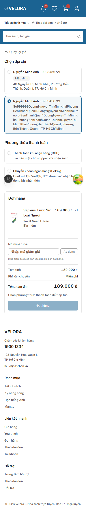

### SF-19

**Nội dung checkout sát mép màn hình** · [hồ sơ lỗi](../../storefront/loi.md#sf-19)

| Mục | Nội dung |
| --- | --- |
| Kết quả | Đã xác nhận |
| Bản sửa | storefront PR #77 (`b3444b9`) |
| Thực tế khi chạy lại | Checkout 1440px: nội dung cách mép trái 80px, khung header bắt đầu 80px |
| Bằng chứng | [1-checkout-1440](SF-19/1-checkout-1440.png) · [api-response](SF-19/api-response.txt) |

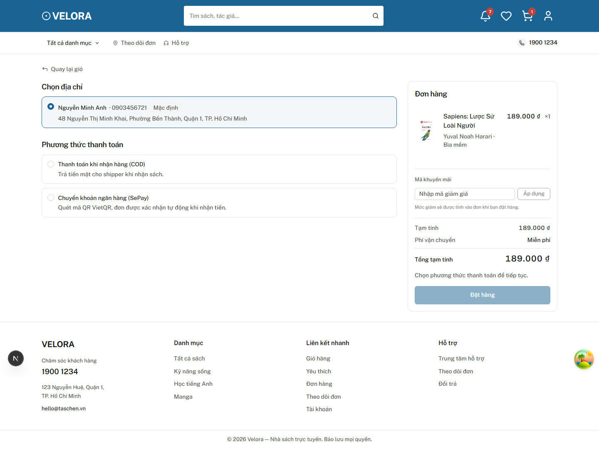

### SF-20

**Khung thông báo bị cắt ở điện thoại** · [hồ sơ lỗi](../../storefront/loi.md#sf-20)

| Mục | Nội dung |
| --- | --- |
| Kết quả | Đã xác nhận |
| Bản sửa | storefront PR #77 (`b3444b9`) |
| Thực tế khi chạy lại | Khung thông báo ở 390px nằm trong màn hình: trái 13, phải 377 / 390, dưới 584 / 844. |
| Bằng chứng | [1-thong-bao-390](SF-20/1-thong-bao-390.png) · [2-thong-bao-390](SF-20/2-thong-bao-390.png) · [api-response](SF-20/api-response.txt) |

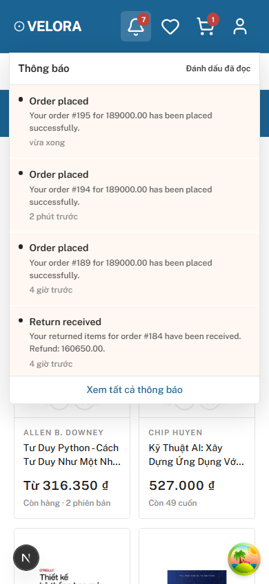

### SF-21

**Nút yêu thích và thêm giỏ không hiện trên cảm ứng** · [hồ sơ lỗi](../../storefront/loi.md#sf-21)

| Mục | Nội dung |
| --- | --- |
| Kết quả | Đã xác nhận |
| Bản sửa | storefront PR #77 (`b3444b9`) |
| Thực tế khi chạy lại | Ở 390px cảm ứng, 4 nút yêu thích/thêm giỏ trên thẻ sách đều hiện sẵn (không cần hover): Thêm vào yêu thích 29x29, Thêm vào yêu thích 29x29, Thêm vào giỏ 29x29, Thêm vào yêu thích 29x29 |
| Bằng chứng | [1-danh-sach-375](SF-21/1-danh-sach-375.png) · [2-nut-tren-the-sach-390](SF-21/2-nut-tren-the-sach-390.png) · [3-sau-khi-cham](SF-21/3-sau-khi-cham.png) · [api-response](SF-21/api-response.txt) |

### SF-22

**Chip lọc trạng thái đơn hàng hiển thị tiếng Anh** · [hồ sơ lỗi](../../storefront/loi.md#sf-22)

| Mục | Nội dung |
| --- | --- |
| Kết quả | Đã xác nhận |
| Bản sửa | storefront PR #77 (`b3444b9`) |
| Thực tế khi chạy lại | Chip và trạng thái ở /vi/orders: nhãn tiếng Anh không có; tab Đổi/Trả: không có |
| Bằng chứng | [1-don-hang](SF-22/1-don-hang.png) · [2-doi-tra](SF-22/2-doi-tra.png) · [api-response](SF-22/api-response.txt) |

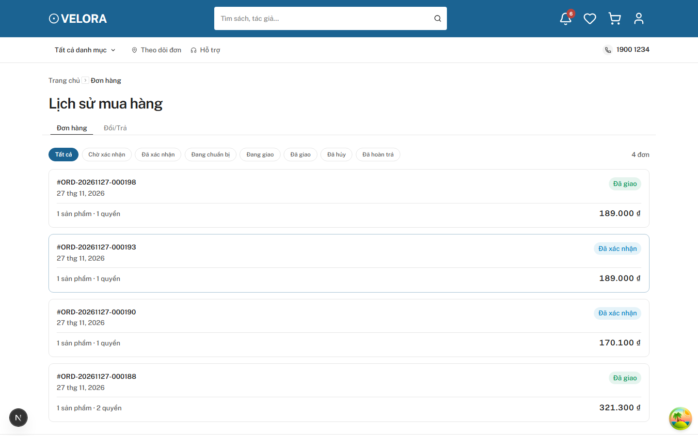

### SF-23

**Breadcrumb chồng chữ trên điện thoại** · [hồ sơ lỗi](../../storefront/loi.md#sf-23)

| Mục | Nội dung |
| --- | --- |
| Kết quả | Đã xác nhận |
| Bản sửa | storefront PR #77 (`b3444b9`) |
| Thực tế khi chạy lại | Breadcrumb sách tên dài nhất (93 ký tự) ở 375px: {'items': 3, 'overlap': 0, 'right': 355, 'vw': 375} |
| Bằng chứng | [1-breadcrumb-375](SF-23/1-breadcrumb-375.png) · [api-response](SF-23/api-response.txt) |

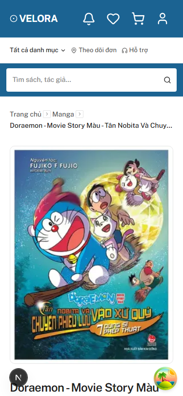

### SF-24

**Khách chưa đăng nhập thấy trạng thái rỗng của đơn hàng và thông báo** · [hồ sơ lỗi](../../storefront/loi.md#sf-24)

| Mục | Nội dung |
| --- | --- |
| Kết quả | Đã xác nhận |
| Bản sửa | storefront PR #77 (`b3444b9`) |
| Thực tế khi chạy lại | Khách chưa đăng nhập: trang Đơn hàng nhắc đăng nhập; menu thông báo nhắc đăng nhập |
| Bằng chứng | [1-don-hang-khach](SF-24/1-don-hang-khach.png) · [2-thong-bao-khach](SF-24/2-thong-bao-khach.png) · [api-response](SF-24/api-response.txt) |

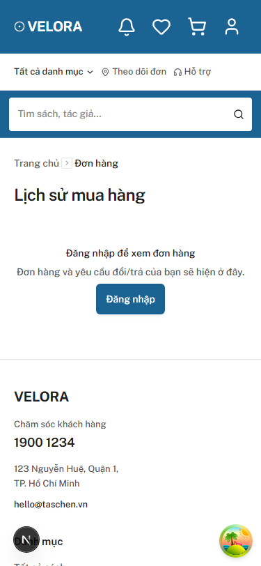

### SF-25

**Menu phụ điện thoại bị chật và cắt chữ** · [hồ sơ lỗi](../../storefront/loi.md#sf-25)

| Mục | Nội dung |
| --- | --- |
| Kết quả | Đã xác nhận |
| Bản sửa | storefront PR #77 (`b3444b9`) |
| Thực tế khi chạy lại | Menu phụ ở 375 và 413px (đo ở /vi/books, trang chủ đang lỗi do SF-45): chữ bị bẻ dòng không, liên kết khuất không cuộn được không |
| Bằng chứng | [1-menu-phu-375](SF-25/1-menu-phu-375.png) · [1-menu-phu-413](SF-25/1-menu-phu-413.png) · [api-response](SF-25/api-response.txt) |

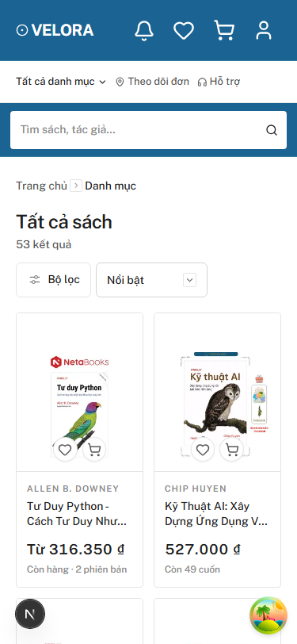

### SF-26

**Đường dẫn không tồn tại hiển thị trang 404 mặc định** · [hồ sơ lỗi](../../storefront/loi.md#sf-26)

| Mục | Nội dung |
| --- | --- |
| Kết quả | Đã xác nhận |
| Bản sửa | storefront PR #77 (`b3444b9`) |
| Thực tế khi chạy lại | HTTP 404, trang 404 của Velora có header và thông báo tiếng Việt |
| Bằng chứng | [1-404](SF-26/1-404.png) · [api-response](SF-26/api-response.txt) |

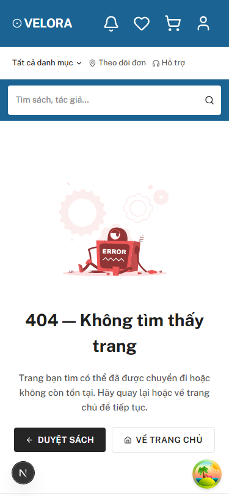

### SF-30

**Đăng nhập sai nhiều lần không bị giới hạn** · [hồ sơ lỗi](../../storefront/loi.md#sf-30)

| Mục | Nội dung |
| --- | --- |
| Kết quả | Đã xác nhận |
| Bản sửa | backend PR #140 (`e06e334`) |
| Thực tế khi chạy lại | Gateway bật giới hạn (APP_RATE_LIMIT_ENABLED=true). 8 lần sai cùng email: [401, 401, 401, 401, 401, 429, 429, 429]; đăng nhập đúng ngay sau: 429. Chưa kiểm hành vi khi Redis lỗi (Redis dùng chung) |
| Bằng chứng | [api-response](SF-30/api-response.txt) |

### SF-40

**Đổi trả đồng thời tạo nhiều yêu cầu cho một cuốn** · [hồ sơ lỗi](../../storefront/loi.md#sf-40)

| Mục | Nội dung |
| --- | --- |
| Kết quả | Đã xác nhận |
| Bản sửa | backend PR #121 (`3fd69ed`) |
| Thực tế khi chạy lại | 5 request tạo trả hàng cùng lúc cho 1 cuốn (đơn ORD-20261127-000198): mã [409, 409, 409, 201, 409]; đơn có 1 yêu cầu trả hàng |
| Bằng chứng | [api-response](SF-40/api-response.txt) |

### SF-04

**notification-service không khởi động vì thiếu biến Mongo** · [hồ sơ lỗi](../../storefront/loi.md#sf-04)

| Mục | Nội dung |
| --- | --- |
| Kết quả | Xác nhận một phần |
| Bản sửa | backend `dev.ps1` trên `develop` |
| Thực tế khi chạy lại | Chạy native với biến như dev.ps1 (NOTIFICATION_MONGO_URI): service khởi động (có), health UP. Docker Compose vẫn truyền MONGO_URI cho notification-service (service đọc NOTIFICATION_MONGO_URI), chưa chạy Compose |
| Bằng chứng | [api-response](SF-04/api-response.txt) |

### SF-13

**Giao diện hiện thương hiệu Taschen thay vì Velora** · [hồ sơ lỗi](../../storefront/loi.md#sf-13)

| Mục | Nội dung |
| --- | --- |
| Kết quả | Xác nhận một phần |
| Bản sửa | storefront PR #77 (`b3444b9`) |
| Thực tế khi chạy lại | Tên thương hiệu và tiêu đề trang Tài khoản đã là Velora ("Velora — Nhà sách trực tuyến"). Còn email liên hệ hello@taschen.vn ở footer mọi trang |
| Bằng chứng | [1-tai-khoan](SF-13/1-tai-khoan.png) · [api-response](SF-13/api-response.txt) |

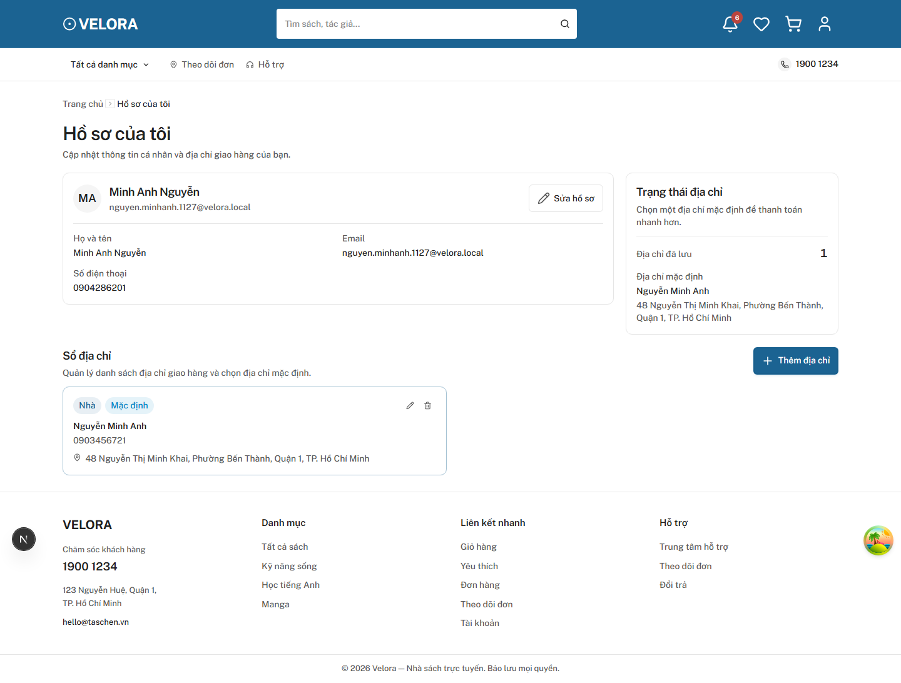

### SF-14

**Tiêu đề tab là Book Store và trạng thái đơn hiện mã tiếng Anh** · [hồ sơ lỗi](../../storefront/loi.md#sf-14)

| Mục | Nội dung |
| --- | --- |
| Kết quả | Xác nhận một phần |
| Bản sửa | storefront PR #77 (`b3444b9`) |
| Thực tế khi chạy lại | Trạng thái đơn đã tiếng Việt. Tiêu đề /vi, /vi/success, /en/success đều là tiêu đề chung "Velora — Nhà sách trực tuyến"; /en vẫn tiêu đề tiếng Việt. Trang chủ đang lỗi do SF-45 nên chưa đo được tiêu đề thật của trang chủ |
| Bằng chứng | [api-response](SF-14/api-response.txt) |

### SF-27

**Nhiều trang dùng chung tiêu đề tab** · [hồ sơ lỗi](../../storefront/loi.md#sf-27)

| Mục | Nội dung |
| --- | --- |
| Kết quả | Còn lỗi |
| Bản sửa | storefront PR #77 (`b3444b9`) |
| Thực tế khi chạy lại | /vi/cart = "Giỏ hàng \| Velora"; /vi/orders = "Đơn hàng \| Velora"; /vi/search?q=python = "Tìm kiếm \| Velora"; /vi/login = "Velora — Nhà sách trực tuyến"; /vi/register = "Velora — Nhà sách trực tuyến". Giỏ, đơn hàng, tìm kiếm đã có tiêu đề riêng; đăng nhập và đăng ký vẫn dùng tiêu đề chung |
| Bằng chứng | [api-response](SF-27/api-response.txt) |

## Ghi nhận thêm khi retest

- Thông báo trên storefront tiếng Việt hiện nội dung tiếng Anh và số tiền thô ("Order placed. Your order #195 for 189000.00 has been placed successfully."), xem ảnh `SF-20/1-thong-bao-390.png`. Chưa có mã theo dõi.
- Đợt retest tạo thêm dữ liệu trên DB dùng chung: đơn ORD-20261127-000198 (đã hoàn tất) và 1 yêu cầu trả hàng cho đơn này (SF-40), đơn mua PO-20261127-000045 chuyển ORDERED (BO-12), 1 sách trong danh sách yêu thích của khách Nguyễn Minh Anh. Địa chỉ dài dùng cho SF-18 đã xoá.

